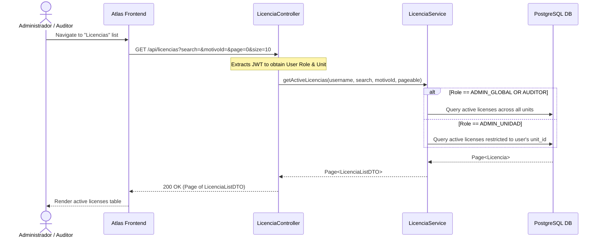
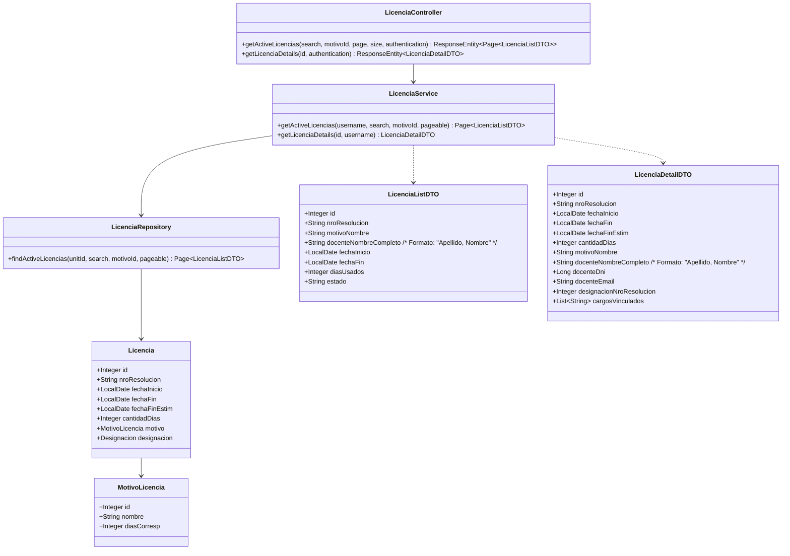
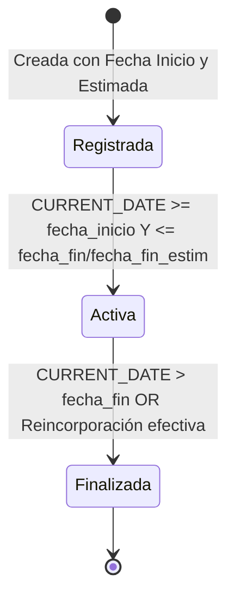

# Solution Diagrams — RF-07

## 1. Sequence Diagram (Mandatory)

This diagram shows the flow of fetching the active licenses list and handling unit-scoped authorization.

---

## 2. Class Diagram (Mandatory)

This diagram models the key backend entities, DTOs, and Spring components for RF-07.

---

## 3. State & Lifecycle Diagram (Supporting Diagram)

Illustrates the lifecycle conditions determining when a license is considered "Activa".

