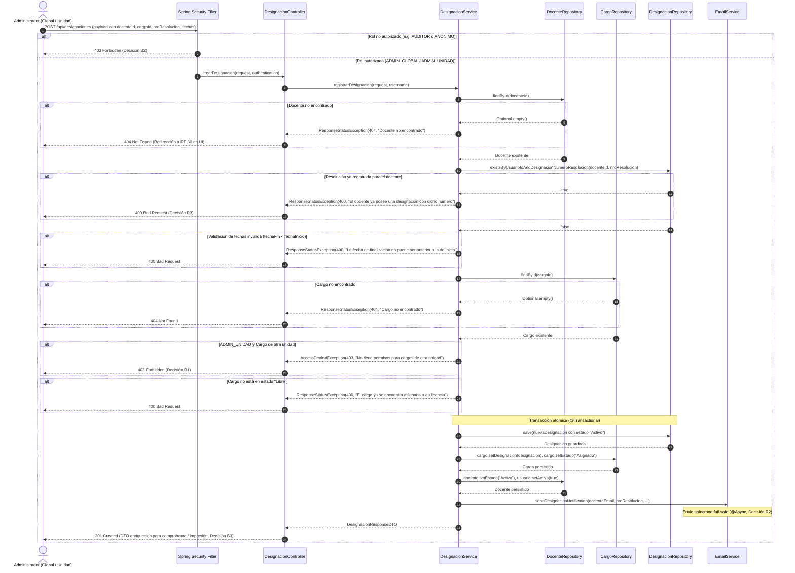
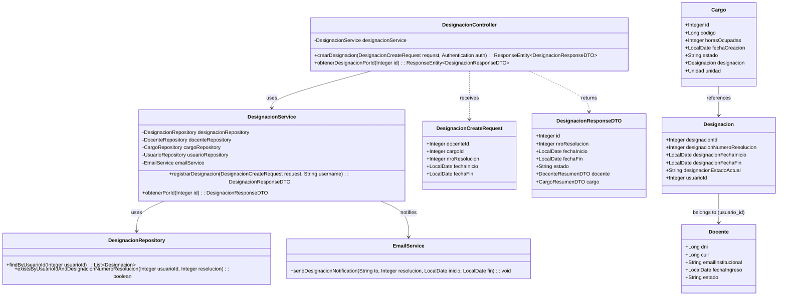
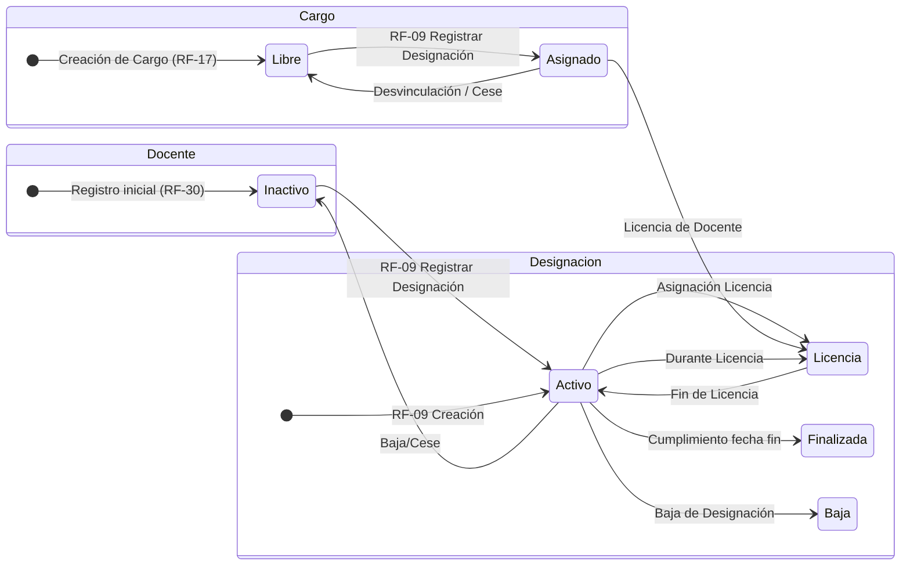

# Solution Diagrams — RF-09: Registrar las designaciones de docentes

This document details the diagrams of the proposed solution for the teacher designation registration workflow.

---

## 1. Sequence Diagram (Mandatory)

Shows the sequence flow of the solution being specified, illustrating the interaction between the client actor, security filters, controller, service, repositories, and notification service.

---

## 2. Class Diagram (Mandatory)

Shows the classes, DTOs, controllers, services, repositories, and entities involved in the solution and their relationships.

---

## 3. State Machine Diagram (Lifecycle of Teacher and Cargo during Designation)

Illustrates the state transitions of the Teacher (`Docente`), the Position (`Cargo`), and the Designation (`Designacion`) when RF-09 is executed.

