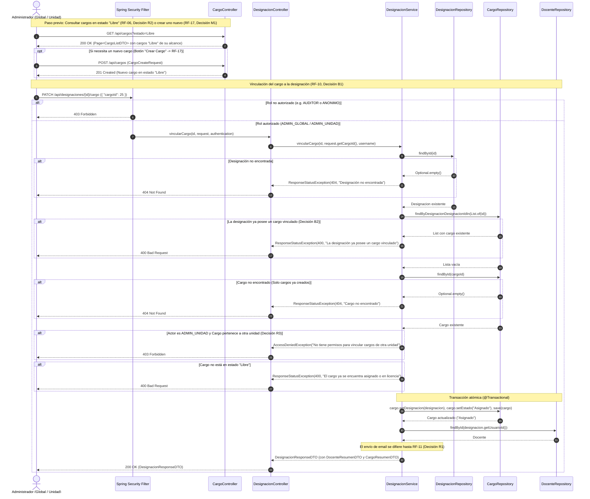
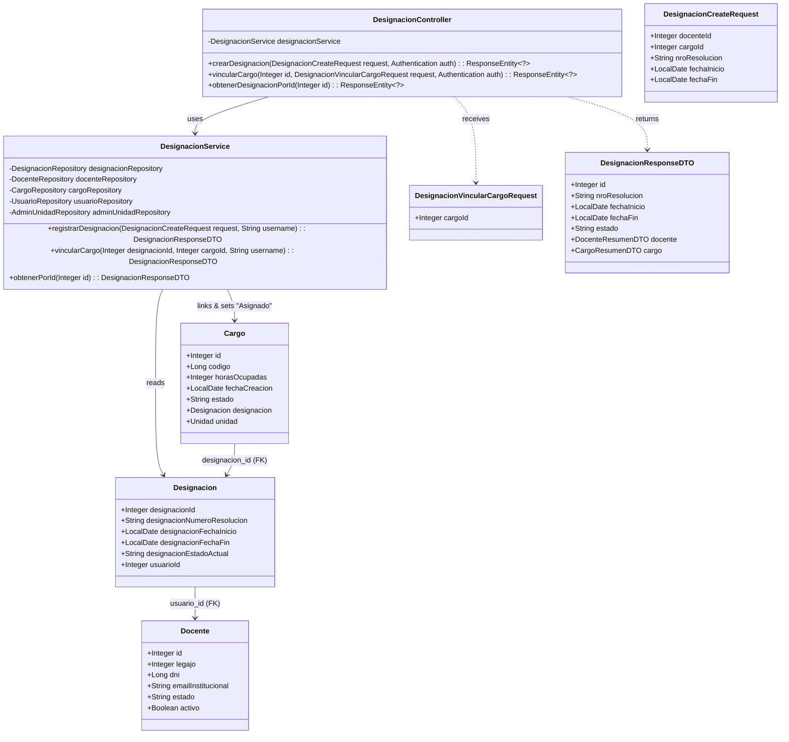
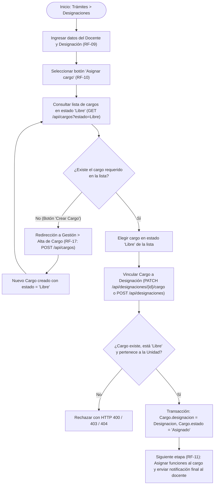

# Solution Diagrams — RF-10: Vincular un cargo a una designación de un docente

This document details the diagrams of the proposed solution for linking an existing `"Libre"` position (`Cargo`) to a teacher's designation (`Designacion`).

---

## 1. Sequence Diagram (Mandatory)

Shows the end-to-end interaction flow between the administrator, the cargo listing/creation endpoints (RF-06 / RF-17), and the designation-cargo linking endpoint (`PATCH /api/designaciones/{id}/cargo`).

---

## 2. Class Diagram (Mandatory)

Shows the classes, DTOs, controllers, services, repositories, and entities involved in linking a `Cargo` to a `Designacion`.

---

## 3. User Workflow & State Transition Diagram

Illustrates the complete administrative journey across RF-09 (Create Designation), RF-17 (Create Cargo if needed), RF-10 (Link Cargo to Designation), and RF-11 (Assign Functions & Final Notification).

