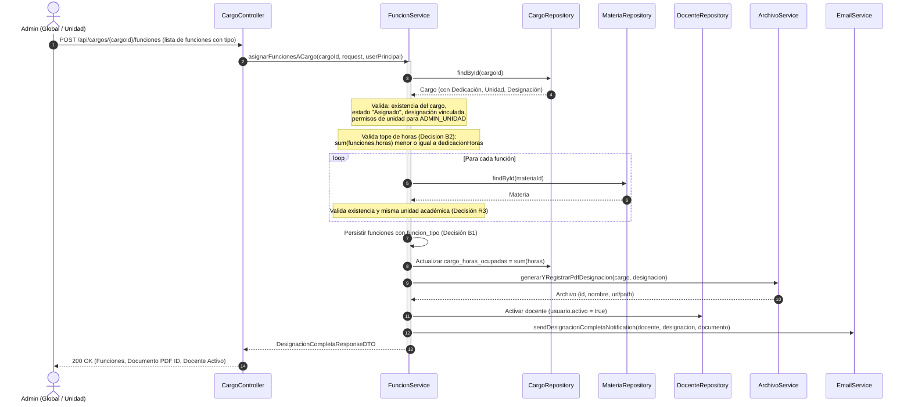
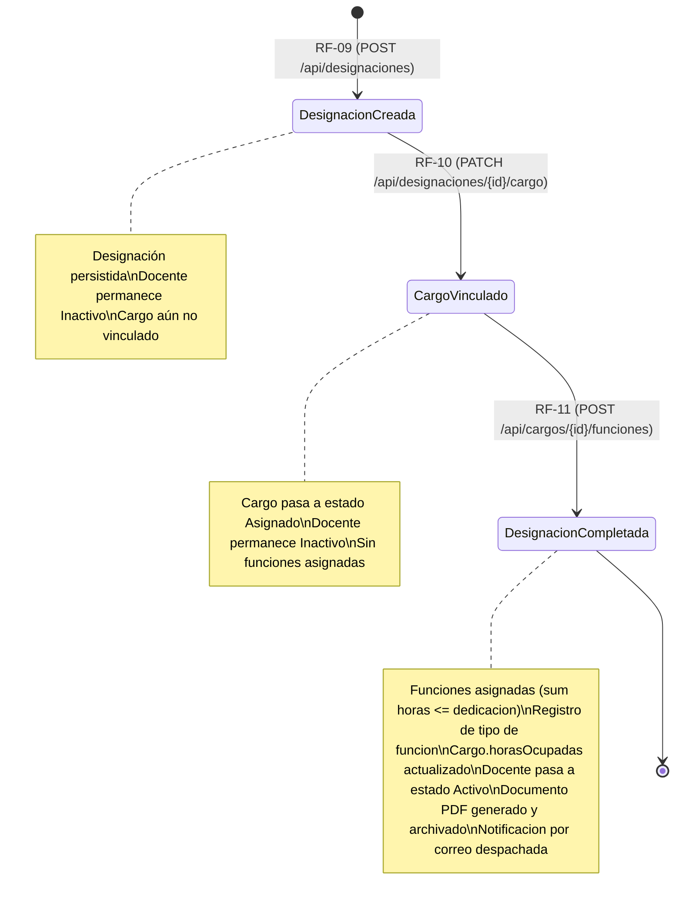

# Diagramas de Solución — RF-11: Asignar funciones a un cargo de una designación

## 1. Diagrama de Secuencia: Asignación de Funciones y Cierre de Designación

## 2. Diagrama de Estados del Trámite de Designación (RF-09 → RF-10 → RF-11)

