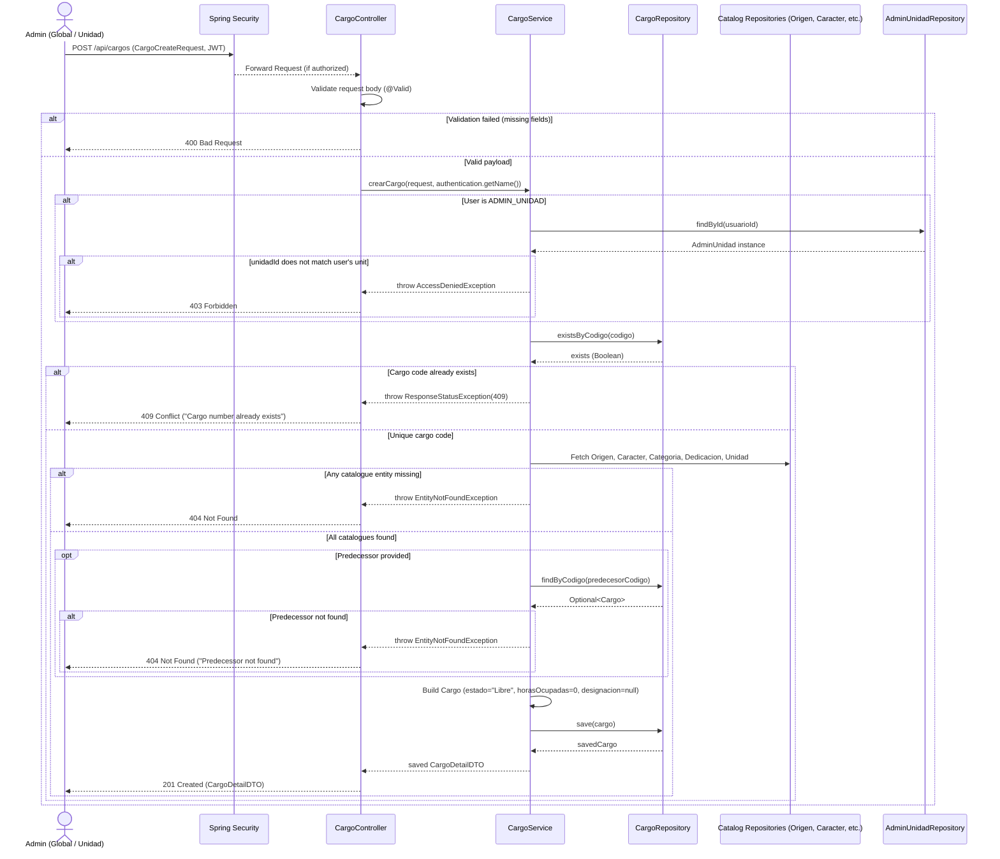
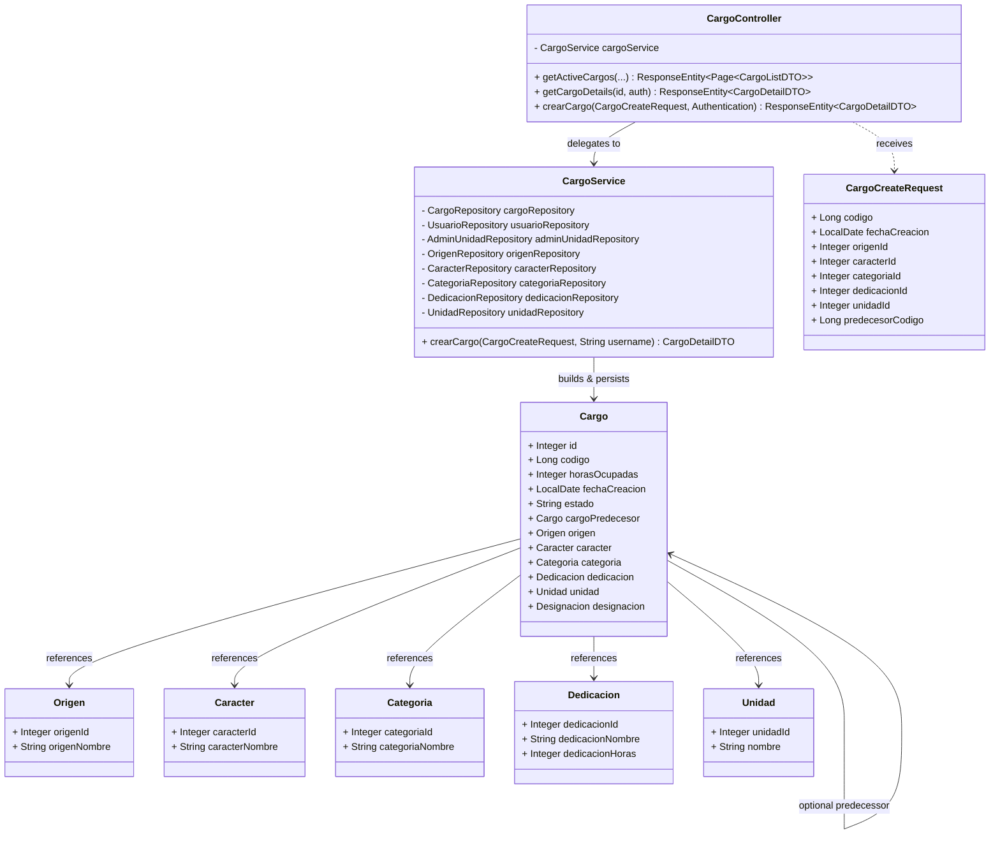
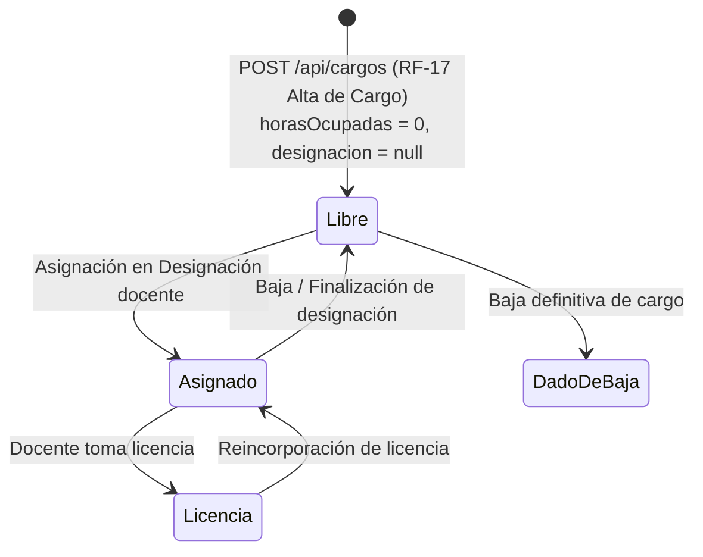

# Solution Diagrams — RF-17

This document details the diagrams of the proposed solution for registering a new position (Alta de un cargo).

---

## 1. Sequence Diagram (Mandatory)

Shows the interaction flow between the actors, Spring Security, controller, service, and repositories when registering a cargo.

---

## 2. Class Diagram (Mandatory)

Outlines the static class structure, controller, service, DTOs, and relationships.

---

## 3. Additional Useful Diagram: State & Lifecycle Diagram

Illustrates the initial creation state of the Cargo and where it fits in the broader system lifecycle.

