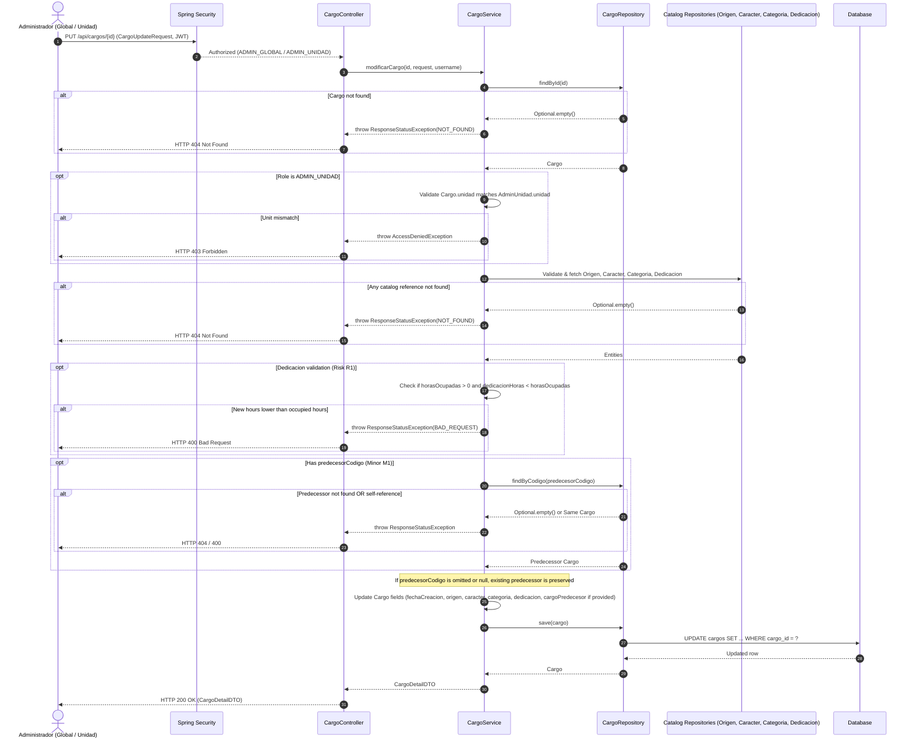
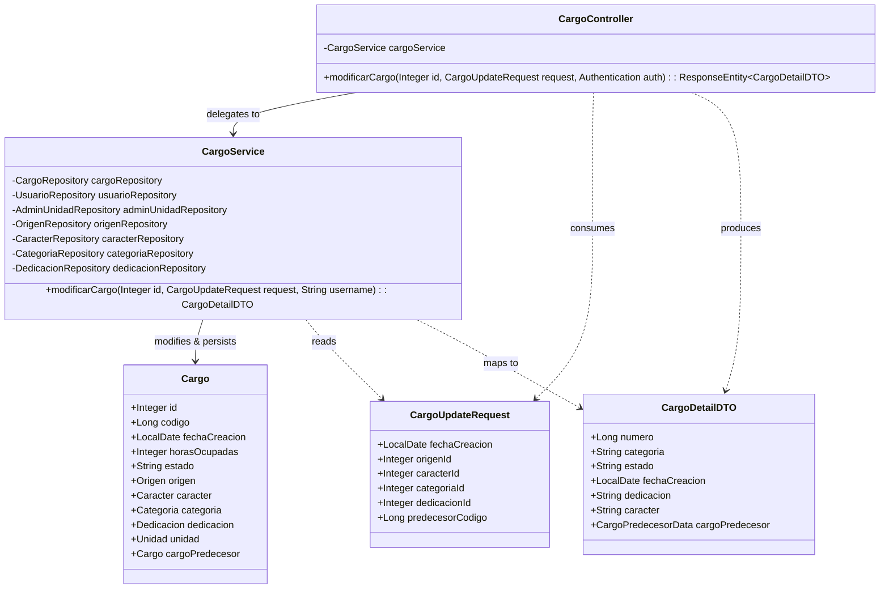
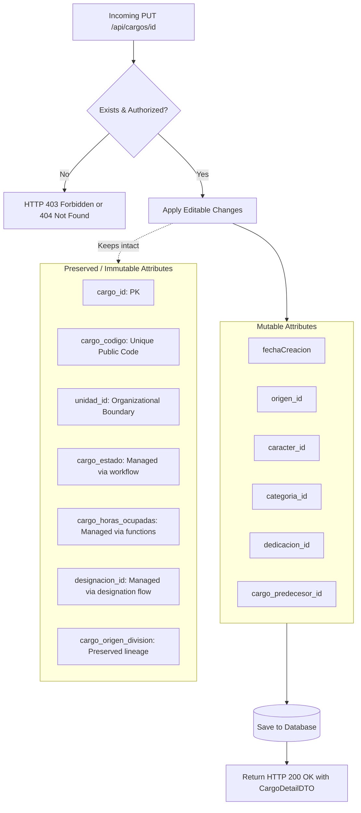

# Solution Diagrams — RF-18: Modificar los datos de un cargo

This document details the diagrams of the proposed solution to understand the implementation.

---

## 1. Sequence Diagram (Mandatory)

Shows the sequence flow of the cargo update process, illustrating interaction between the client, security layer, controller, service, and database repositories.

---

## 2. Class Diagram (Mandatory)

Shows the classes, DTOs, controllers, services, repositories, and relationships involved in the update solution.

---

## 3. Additional Useful Diagram: State & Invariants Transition Flow

Illustrates which fields are mutable via `PUT /api/cargos/{id}` and which are preserved as invariants.

