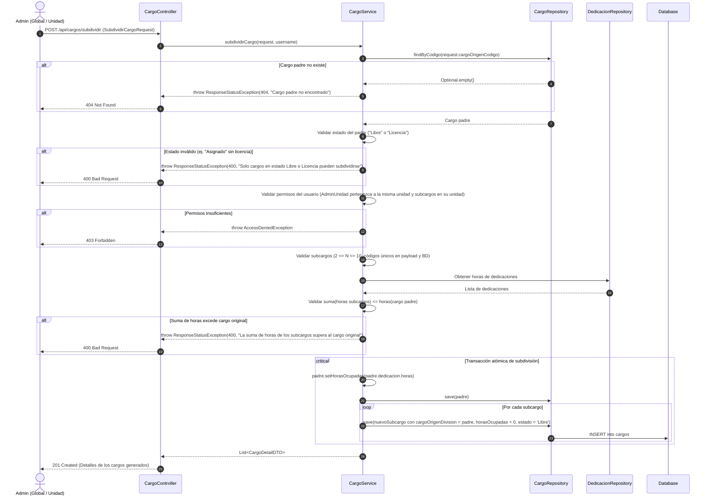
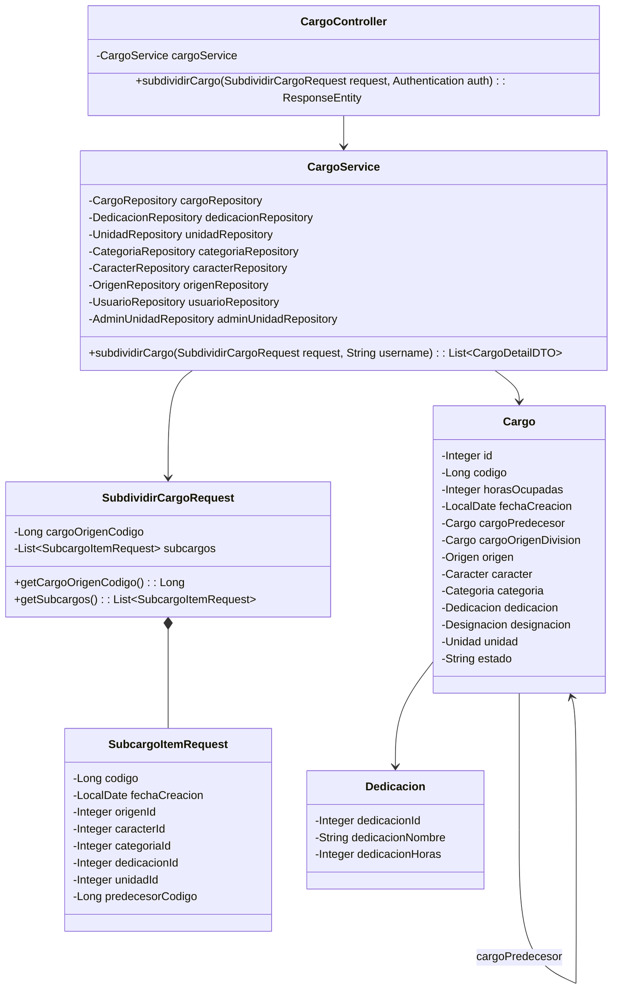
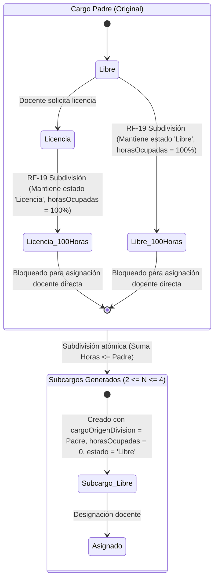

# Solution Diagrams — RF-19: Subdividir un cargo en 2 o más cargos

This document details the diagrams of the proposed solution to understand the implementation.

---

## 1. Sequence Diagram (Mandatory)

Shows the sequence flow of the solution being specified, illustrating the interaction between actors, controllers, services, repositories, and the database.

---

## 2. Class Diagram (Mandatory)

Shows the classes, interfaces, attributes, and methods involved in the solution and their relationships.

---

## 3. Additional Useful Diagram: State and Relationship Lifecycle

Diagram illustrating the structural hierarchy and status lifecycle when a position is divided into sub-positions according to the resolved decisions.

