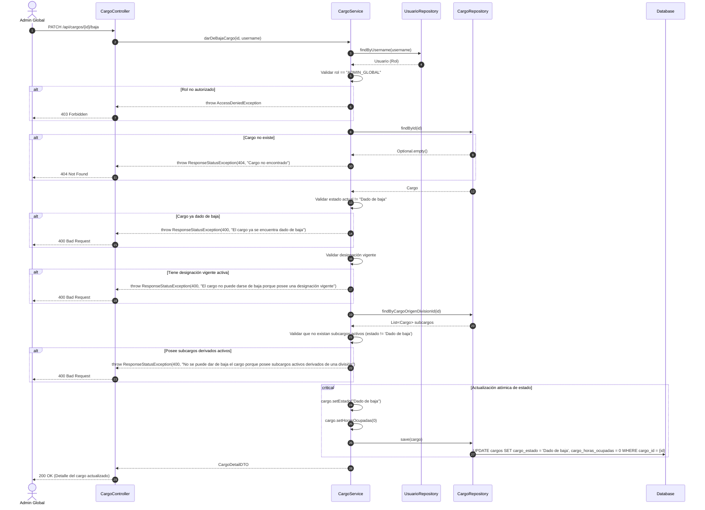
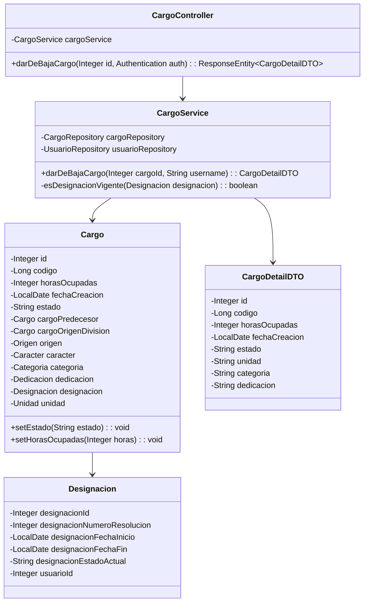
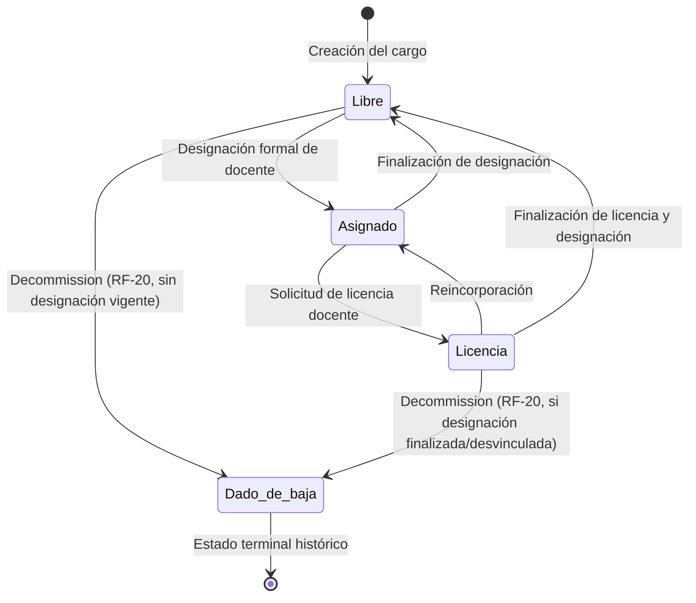

# Solution Diagrams — RF-20: Baja de un cargo

This document details the diagrams of the proposed solution for decommissioning a position.

---

## 1. Sequence Diagram

Illustrates the end-to-end execution flow of the decommissioning endpoint, role validation, designation checks, and persistence.

---

## 2. Class Diagram

Shows the components, services, repositories, and domain models involved in the decommissioning operation.

---

## 3. State Lifecycle Diagram

Shows the state transitions of a `Cargo` entity highlighting the decommission transition.

