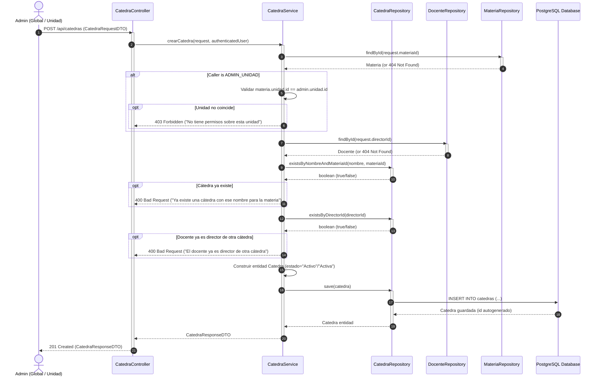
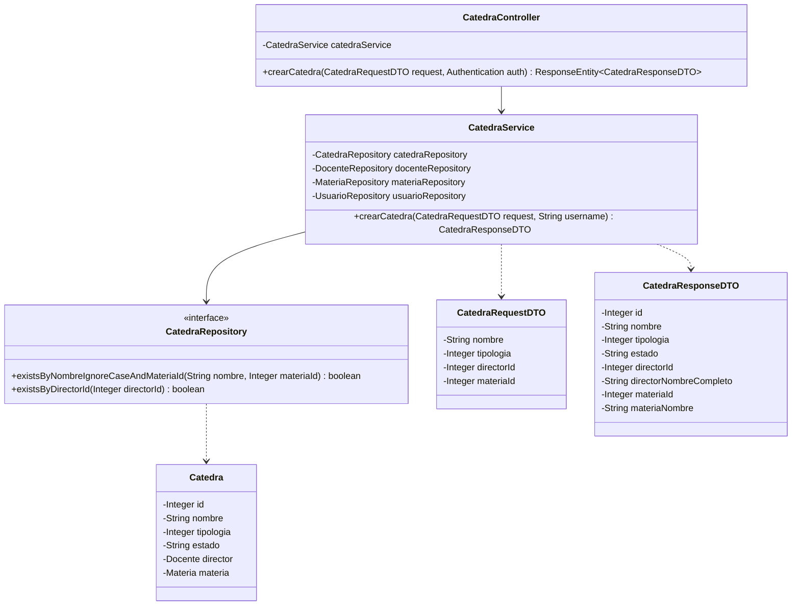
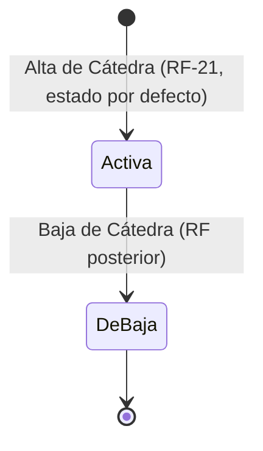

# Solution Diagrams — RF-21: Alta de una cátedra

This document details the diagrams of the proposed solution to understand the implementation.

---

## 1. Sequence Diagram (Alta de Cátedra)

Shows the sequence flow of creating a new catedra, illustrating the interactions between Actor, Controller, Service, Repositories, and the Database.

---

## 2. Class Diagram

Shows the classes, interfaces, DTOs, and relationships involved in the solution.

---

## 3. State & Lifecycle Diagram

Shows the lifecycle states of a `Catedra`.

