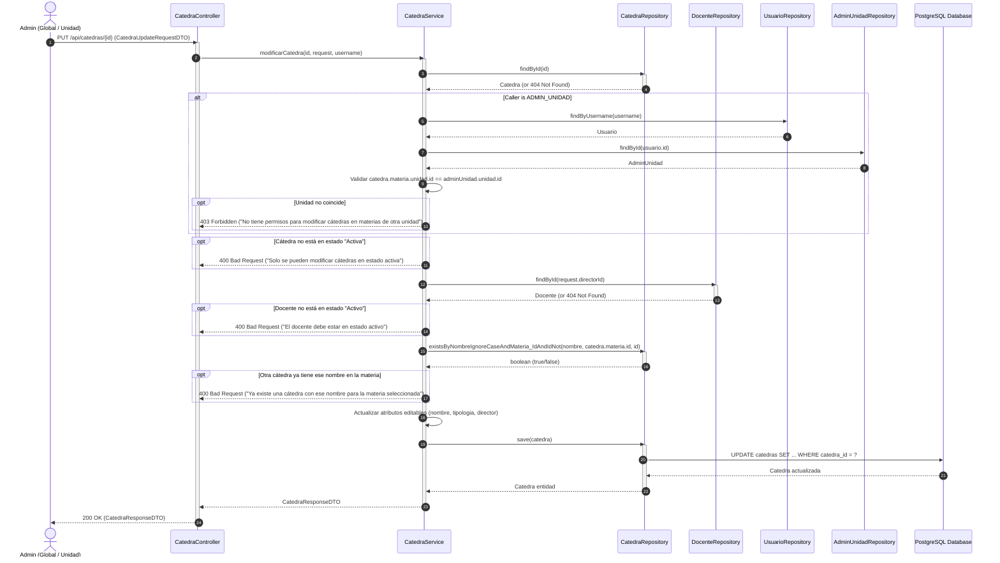
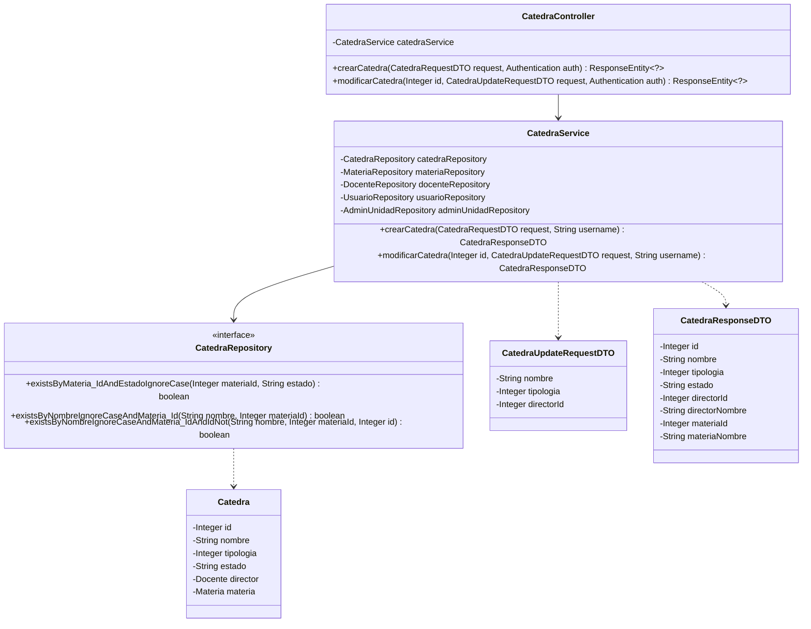
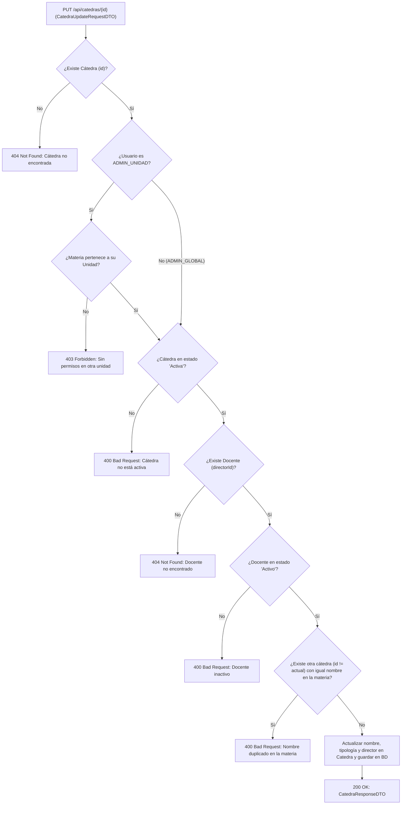

# Solution Diagrams — RF-22: Modificar los datos de una cátedra

This document details the diagrams of the proposed solution to understand the implementation.

---

## 1. Sequence Diagram (Modificación de Cátedra)

Shows the sequence flow of modifying an existing catedra (`PUT /api/catedras/{id}`), illustrating the interactions between Actor, Controller, Service, Repositories, and the Database.

---

## 2. Class Diagram

Shows the classes, interfaces, DTOs, and relationships involved in the modification of a `Catedra`.

---

## 3. Validation & Decision Flow Diagram

Shows the validation pipeline executed during `PUT /api/catedras/{id}`.

