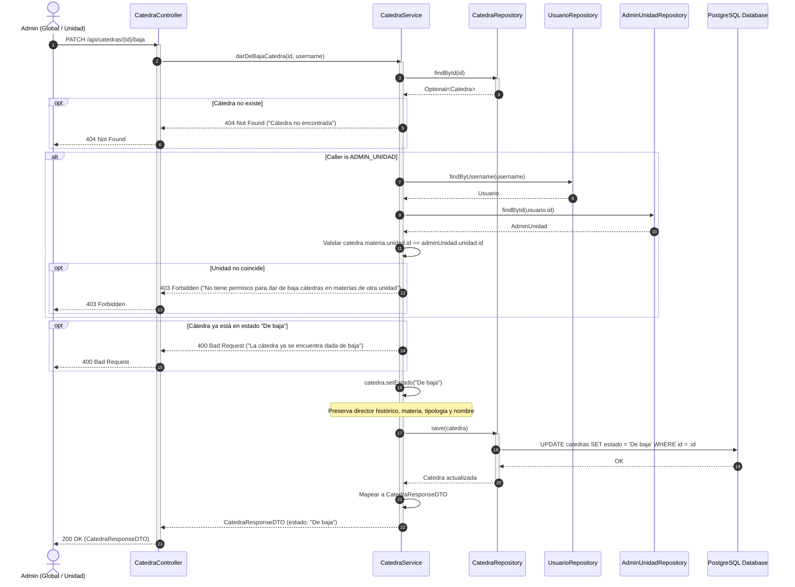
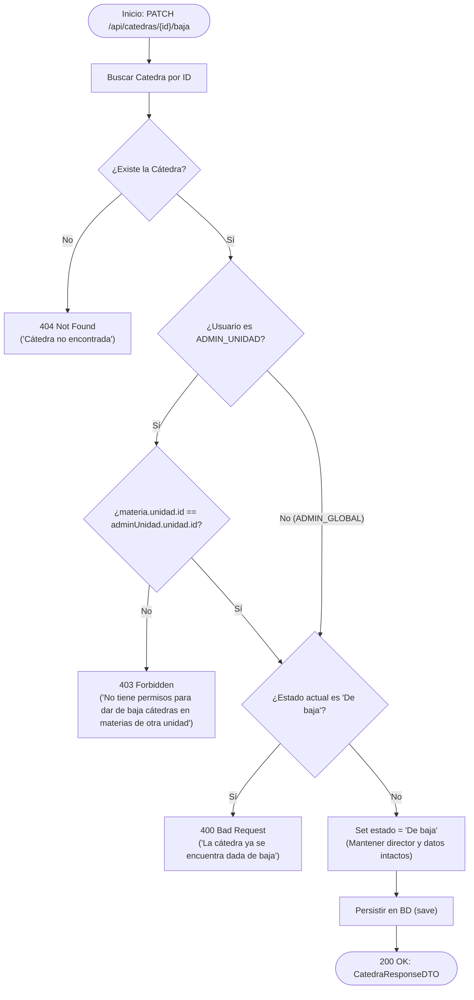
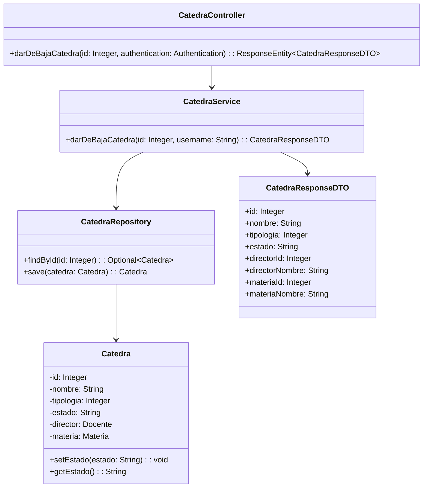

# Solution Diagrams — RF-23: Baja de una cátedra

This document details the diagrams of the proposed solution to understand the implementation.

---

## 1. Sequence Diagram (Baja de Cátedra)

Shows the sequence flow of decommissioning an existing catedra (`PATCH /api/catedras/{id}/baja`), illustrating the interactions between Actor, Controller, Service, Repositories, and the Database.

---

## 2. Activity / Validation Flow Diagram

Illustrates the decision tree during the decommission lifecycle operation.

---

## 3. Class Diagram & Architecture

Highlights the components participating in the decommission slice.

