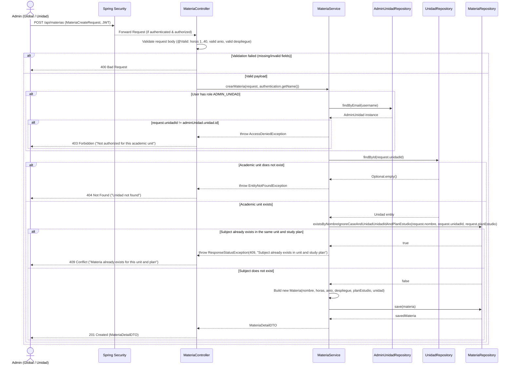
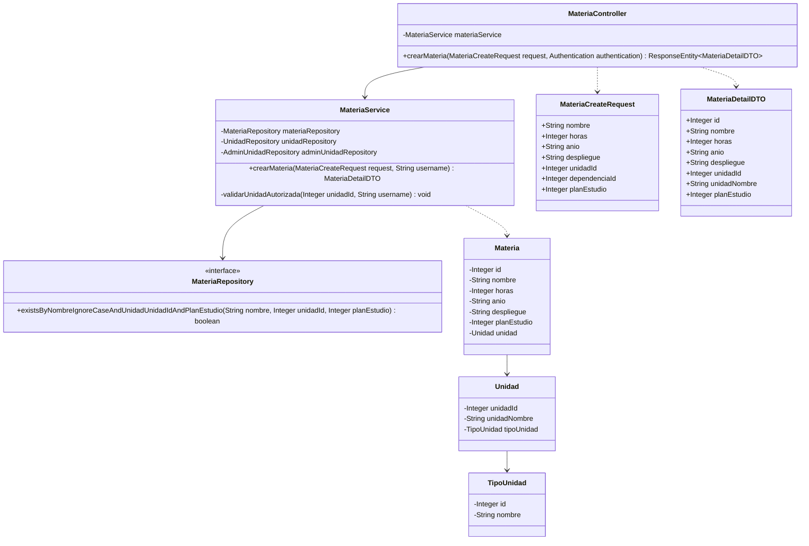
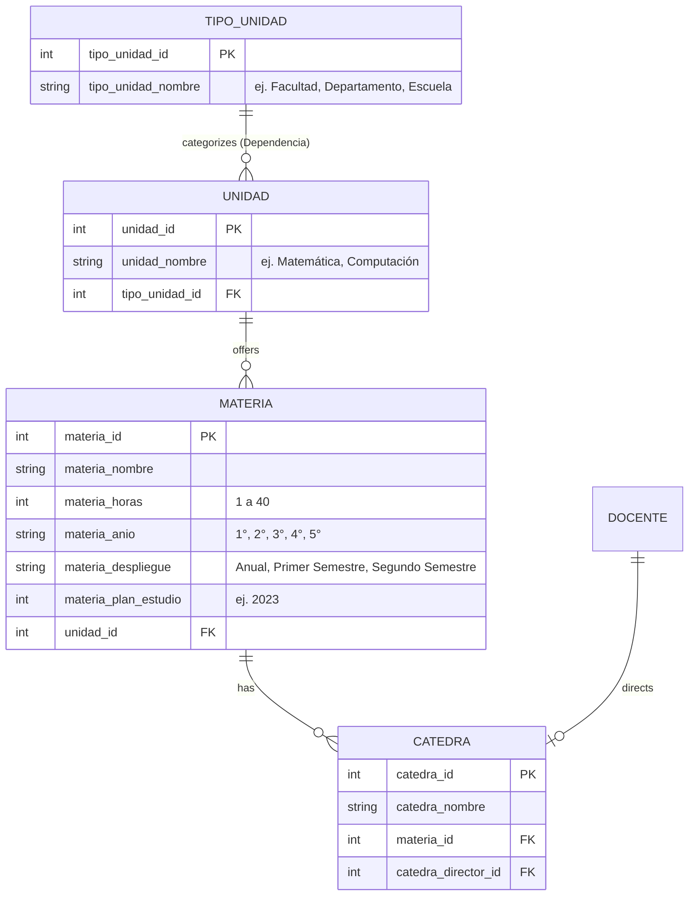

# Solution Diagrams — RF-24

This document details the visual diagrams of the proposed solution for registering a new subject (Alta de una materia).

---

## 1. Sequence Diagram (Mandatory)

Shows the interaction flow between the actors, Spring Security, controller, service, and repositories when registering a subject.

---

## 2. Class Diagram (Mandatory)

Shows the classes, interfaces, attributes, and methods involved in the solution and their relationships.

---

## 3. Entity-Relationship & UI Selector Overview

Shows the relationship between Dependencia (`TipoUnidad`), `Unidad`, `Materia`, and `Catedra`.

