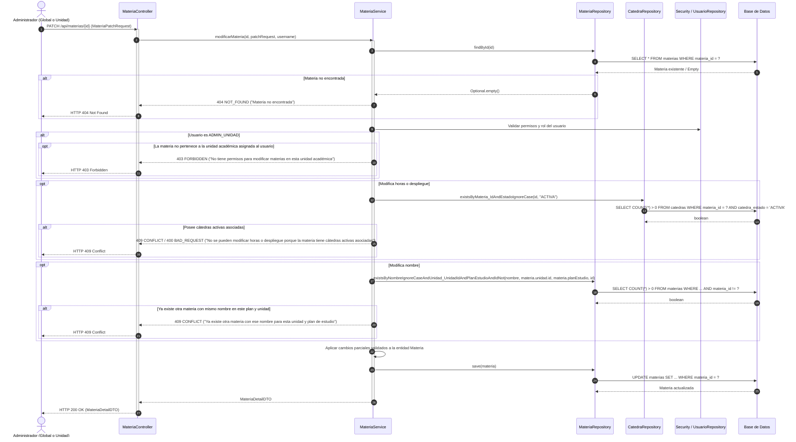
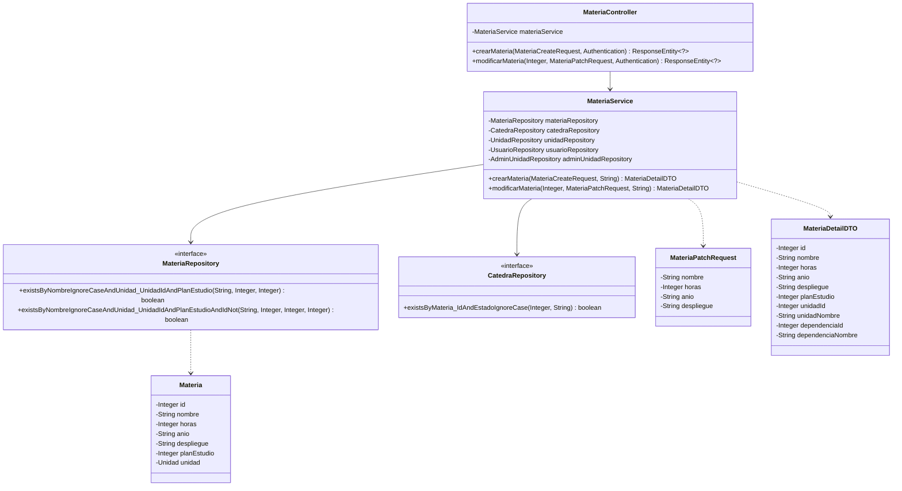

# Solution Diagrams — RF-25: Modificar los datos de una materia

This document details the diagrams of the proposed solution to understand the implementation of subject modification.

---

## 1. Sequence Diagram (Mandatory)

Shows the sequence flow of modifying an existing subject via `PATCH /api/materias/{id}`, illustrating existence check, role scoping, impact verification on active cátedras, uniqueness check excluding self ID, and persistence.



---

## 2. Class Diagram (Mandatory)

Shows the classes, interfaces, attributes, and methods involved in modifying subject data and their relationships.



---

## 3. Additional Useful Diagram: Decision & Validation Flowchart

Shows the step-by-step validation logic for partial modifications (`PATCH`).

```mermaid
flowchart TD
    Start([PATCH /api/materias/{id}]) --> CheckExists{¿Materia existe en BD?}
    CheckExists -- No --> Err404[404 Not Found: Materia no encontrada]
    CheckExists -- Sí --> CheckRole{¿Usuario es ADMIN_UNIDAD?}

    CheckRole -- Sí --> CheckUnitPerm{¿Materia pertenece a su unidad asignada?}
    CheckUnitPerm -- No --> Err403[403 Forbidden: Sin permisos en esta unidad]
    CheckUnitPerm -- Sí --> CheckFields[Validar campos provistos en payload]
    CheckRole -- No (ADMIN_GLOBAL) --> CheckFields

    CheckFields --> CheckCatedras{¿Modifica horas o despliegue y tiene cátedras activas?}
    CheckCatedras -- Sí --> ErrCatedra[409 Conflict: Cátedras activas asociadas]
    CheckCatedras -- No --> CheckNameChange{¿Modifica nombre?}

    CheckNameChange -- No --> UpdateFields[Actualizar campos en memoria]
    CheckNameChange -- Sí --> CheckUniqueness{¿Existe OTRA materia con mismo nombre en este plan y unidad? id != actual}

    CheckUniqueness -- Sí --> Err409[409 Conflict: Nombre duplicado]
    CheckUniqueness -- No --> UpdateFields

    UpdateFields --> SaveDB[Guardar cambios en BD]
    SaveDB --> Success([200 OK: MateriaDetailDTO])
```
