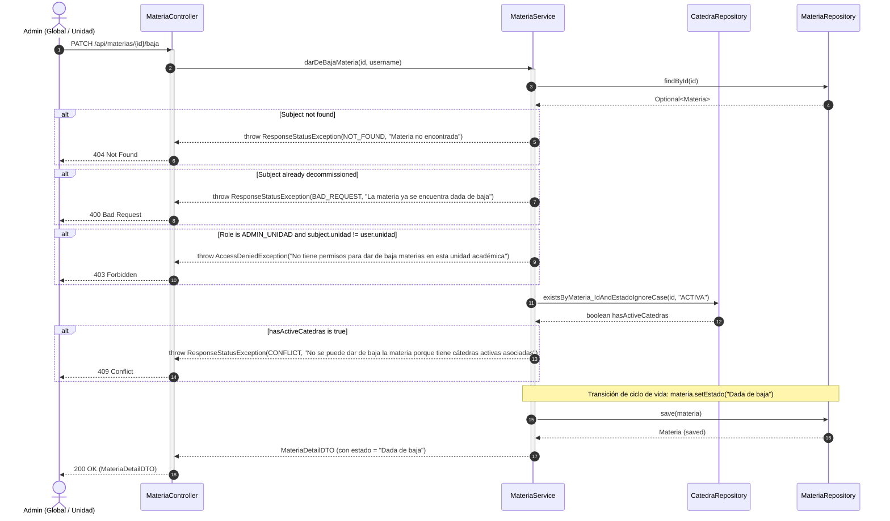
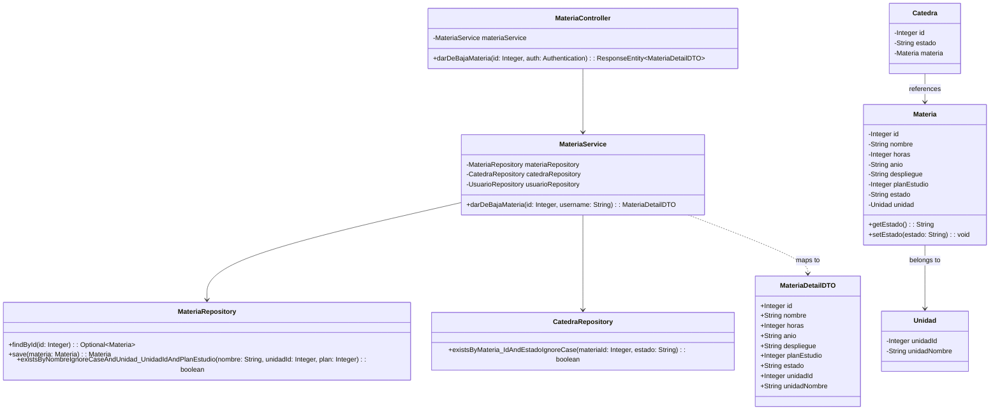
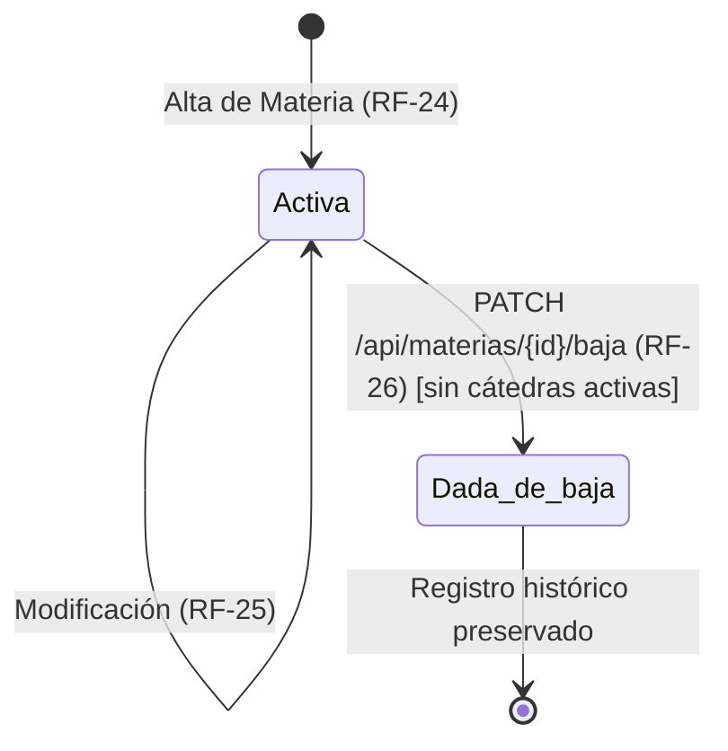

# Solution Diagrams — RF-26: Baja de una materia

This document details the diagrams of the proposed solution for decommissioning a subject via lifecycle state transition (`PATCH /api/materias/{id}/baja`).

---

## 1. Sequence Diagram (Mandatory)

Shows the sequence flow of the decommission operation, illustrating actor interaction, security scoping, active cátedra checks, and state transition.

---

## 2. Class Diagram (Mandatory)

Outlines the participating domain entities, controllers, services, and repositories, including the `estado` lifecycle attribute.

---

## 3. State Transition Diagram

Illustrates the lifecycle states and transitions for the `Materia` entity.

