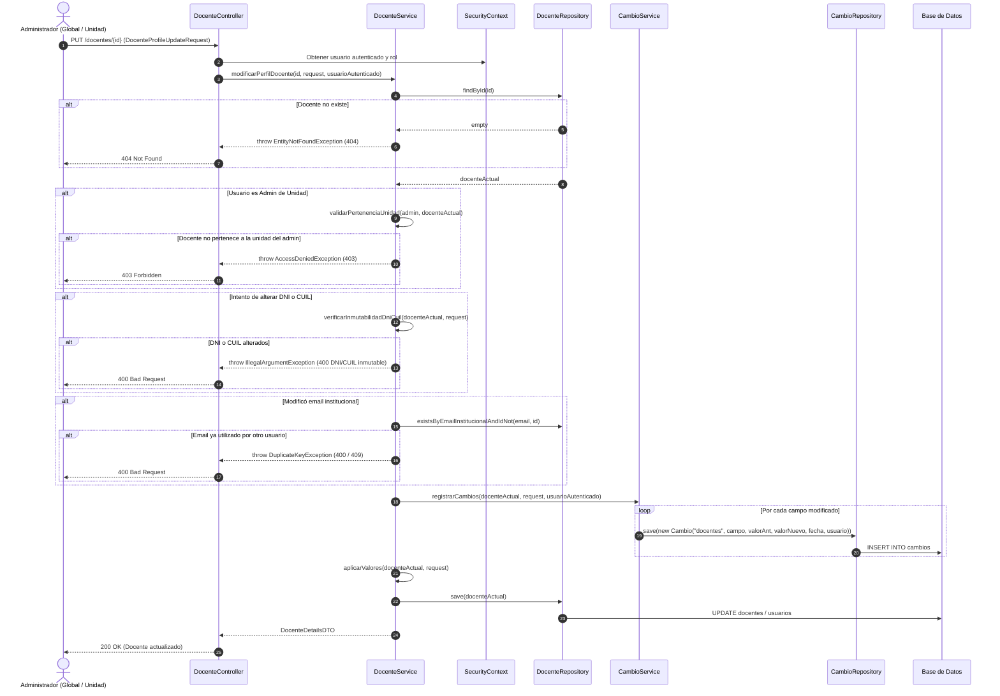
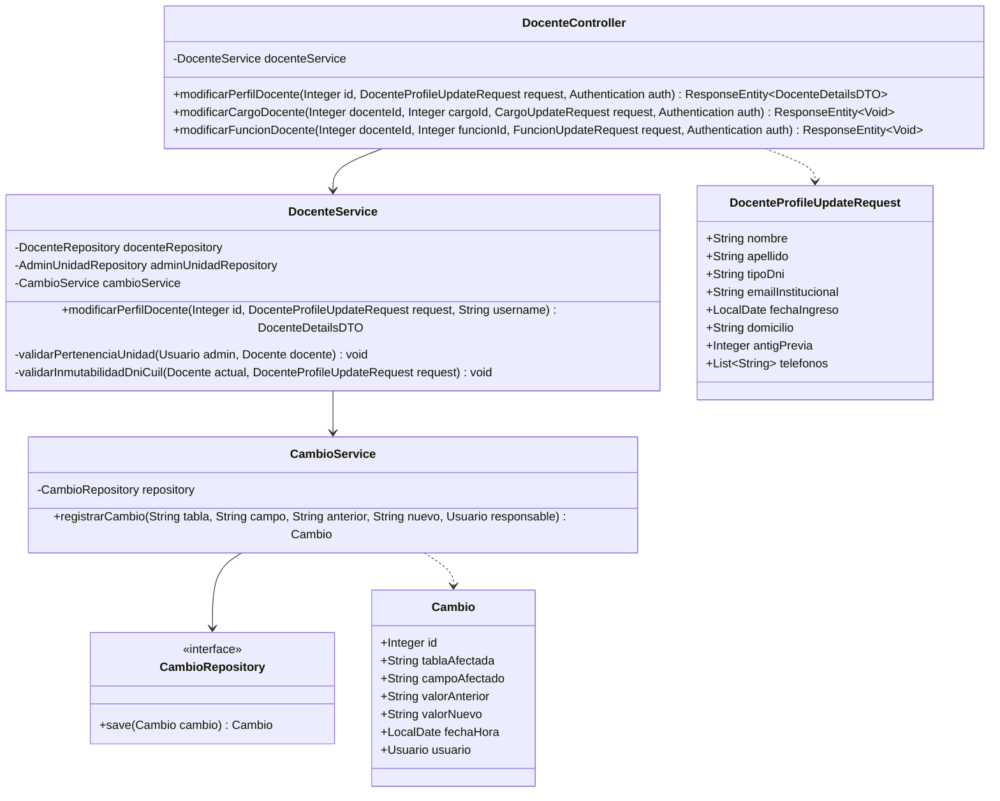

# Solution Diagrams — RF-31

This document details the diagrams of the proposed solution for teacher information modification, taking into account the decisions resolved in `open-questions.md`:
- Dedicated endpoints per modification sector (`perfil`, `cargos`, `funciones`).
- Immutable DNI & CUIL.
- Audit history logging directly into the existing `cambios` table (`Cambio` entity / `CambioService`).
- Unit Administrator isolation (teachers outside the unit cannot be viewed or modified).

---

## 1. Sequence Diagram (Mandatory)

Shows the sequence flow for updating teacher profile information with authorization and audit trail persistence in `cambios`.



---

## 2. Class Diagram (Mandatory)

Shows the classes, interfaces, attributes, and relationships involved in the solution using the existing `Cambio` entity.



---

## 3. Decision and Scope Flow (Additional Diagram)

Flow of authorization and validation for modifying a teacher profile.

```mermaid
flowchart TD
    Start([PUT /docentes/{id}]) --> Find[Buscar Docente en BD]
    Find --> Exists{¿Existe el docente?}
    Exists -- No --> Err404[404 Not Found]
    Exists -- Sí --> RoleCheck{¿Rol del solicitante?}

    RoleCheck -- Admin Unidad --> CheckUnit{¿Docente tiene cargo<br/>activo en su Unidad?}
    CheckUnit -- No --> Err403[403 Forbidden]
    CheckUnit -- Sí --> CheckImmutable[Verificar DNI y CUIL]

    RoleCheck -- Admin Global --> CheckImmutable

    CheckImmutable --> ImmutableValid{¿DNI/CUIL intactos?}
    ImmutableValid -- No --> Err400Dni[400 Bad Request: DNI/CUIL inmutables]
    ImmutableValid -- Sí --> CheckEmail{¿Cambió Email?}

    CheckEmail -- Sí --> EmailUnique{¿Email ya existe?}
    EmailUnique -- Sí --> Err400Email[400 Bad Request: Email duplicado]
    EmailUnique -- No --> TrackDeltas[Detectar campos modificados]
    CheckEmail -- No --> TrackDeltas

    TrackDeltas --> InsertCambios[Insertar registros en tabla cambios]
    InsertCambios --> UpdateDocente[Actualizar Docente y Usuario]
    UpdateDocente --> Resp200([200 OK con Perfil Actualizado])
```
