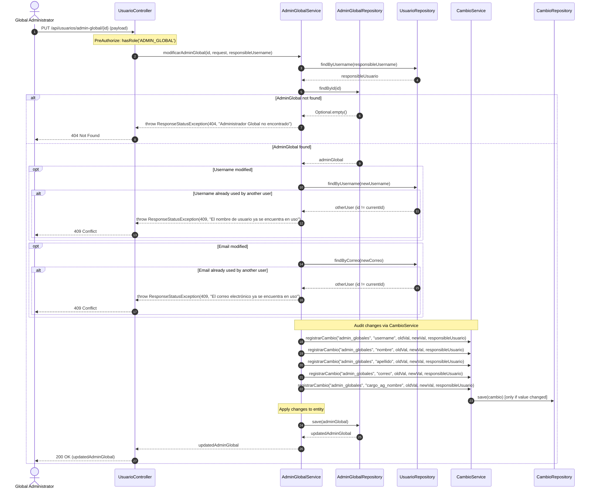
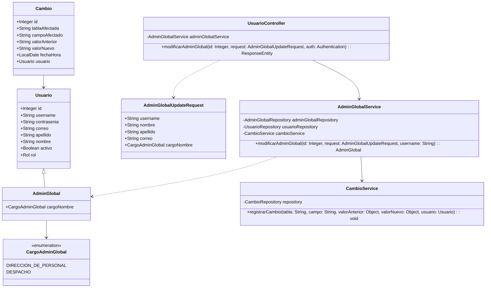
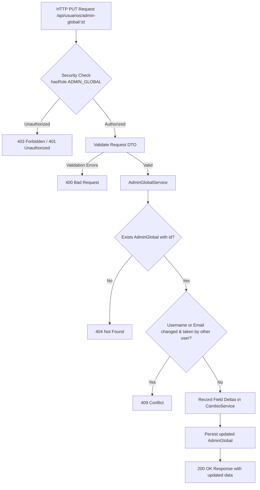

# Solution Diagrams — RF-32

This document details the diagrams of the proposed solution for modifying Global Administrators.

---

## 1. Sequence Diagram (Mandatory)

Shows the sequence flow when a Global Administrator updates another Global Administrator's profile and cargo.

---

## 2. Class Diagram (Mandatory)

Outlines the entities, DTOs, controllers, and services involved in RF-32.

---

## 3. Data Flow and Component Architecture

