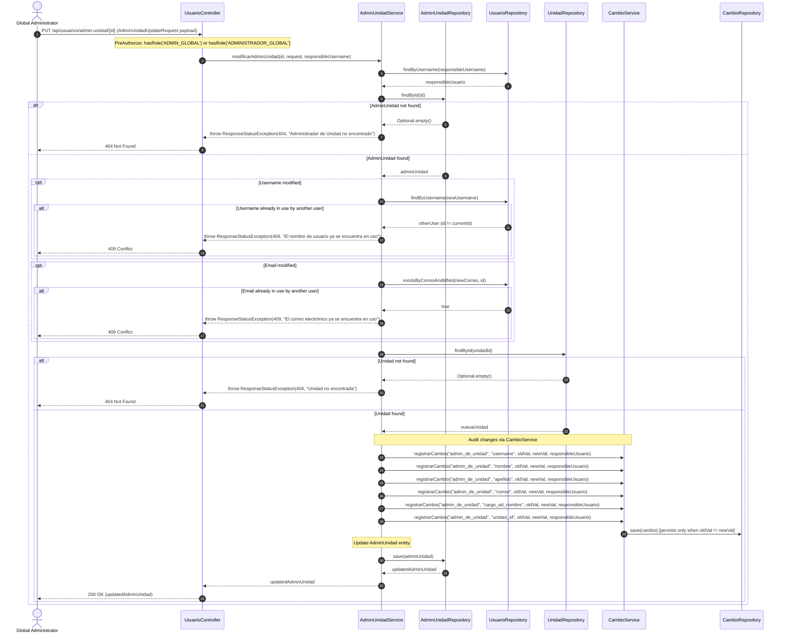
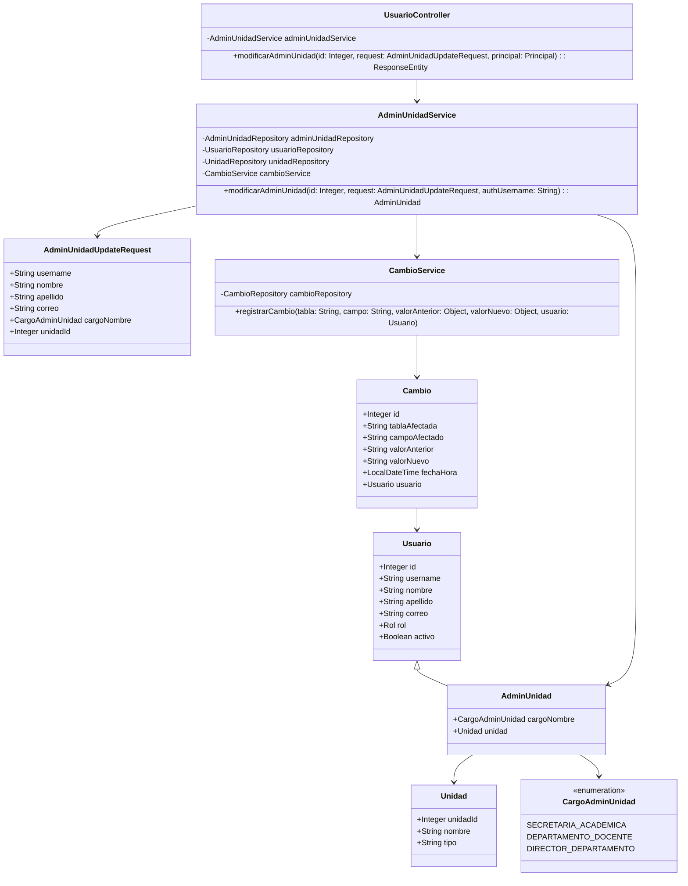

# Solution Diagrams — RF-33

This document details the diagrams of the proposed solution for modifying Unit Administrators.

---

## 1. Sequence Diagram (Mandatory)

Shows the sequence flow when a Global Administrator updates an Admin de Unidad profile, cargo, and academic unit.



---

## 2. Class Diagram (Mandatory)

Outlines the entities, DTOs, controllers, and services involved in RF-33.



---

## 3. Component and Data Flow Architecture

Shows how data flows through the layers from the HTTP boundary to persistence and auditing.

```mermaid
graph TD
    Client["Client (Browser / Global Admin)"] -->|PUT /api/usuarios/admin-unidad/{id}| Controller["UsuarioController"]
    Controller -->|DTO Validation @Valid| RequestDTO["AdminUnidadUpdateRequest"]
    Controller -->|Delegates execution| Service["AdminUnidadService"]
    
    Service -->|Verify collision| UserRepo[("UsuarioRepository")]
    Service -->|Find Unit| UnitRepo[("UnidadRepository")]
    Service -->|Load AdminUnidad| AdminRepo[("AdminUnidadRepository")]
    
    Service -->|Audit delta per field| AuditService["CambioService"]
    AuditService -->|Persist if changed| CambioRepo[("CambioRepository")]
    
    Service -->|Persist updated user| AdminRepo
    Service -->|Return entity| Controller
    Controller -->|200 OK + JSON| Client
```
