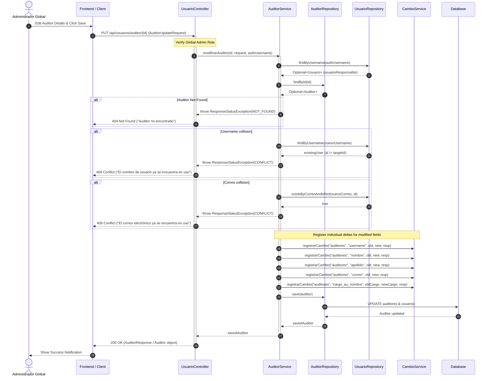

# RF-34 — Solution Diagrams

## Sequence Diagram — Modify Auditor Flow



## Architectural Component Diagram

```mermaid
graph TD
    subgraph REST API Layer
        UC[UsuarioController<br>PUT /api/usuarios/auditor/{id}]
        AUR[AuditorUpdateRequest]
    end

    subgraph Service Layer
        AS[AuditorService<br>modificarAuditor]
        CS[CambioService<br>registrarCambio]
    end

    subgraph Data Access Layer
        AR[AuditorRepository]
        UR[UsuarioRepository]
        CR[CambioRepository]
    end

    subgraph Database Tables
        T_USERS[(usuarios)]
        T_AUD[(auditores)]
        T_CAMBIOS[(cambios)]
    end

    UC -->|Validates DTO & Passes Auth| AS
    AUR -.-> UC
    AS -->|Find & Save| AR
    AS -->|Check Uniqueness & Auth User| UR
    AS -->|Delta Logging| CS
    CS -->|Persist Deltas| CR
    AR --> T_USERS
    AR --> T_AUD
    UR --> T_USERS
    CR --> T_CAMBIOS
```
