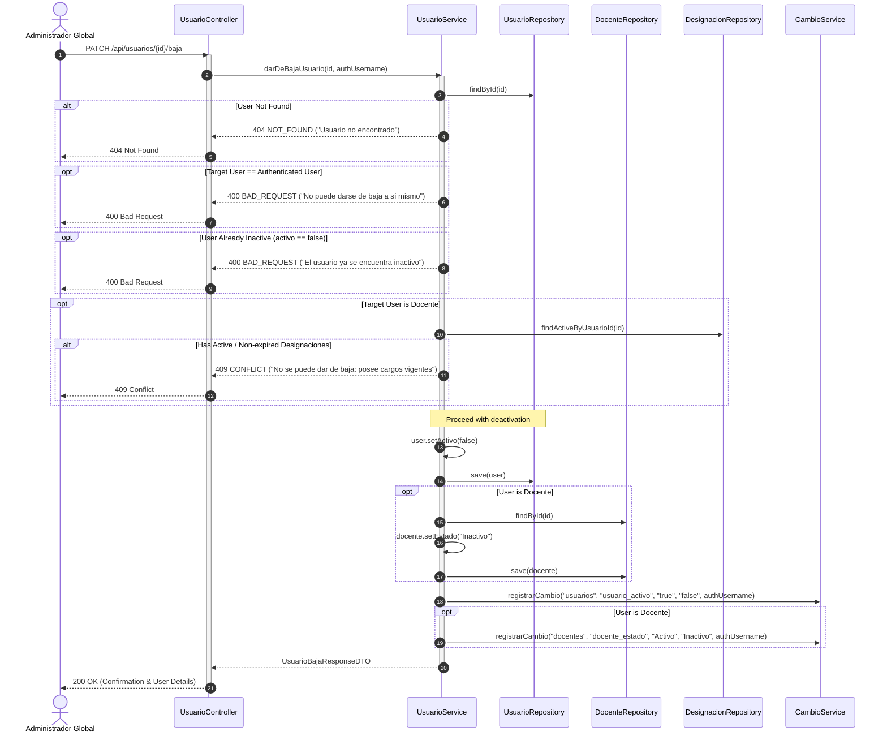
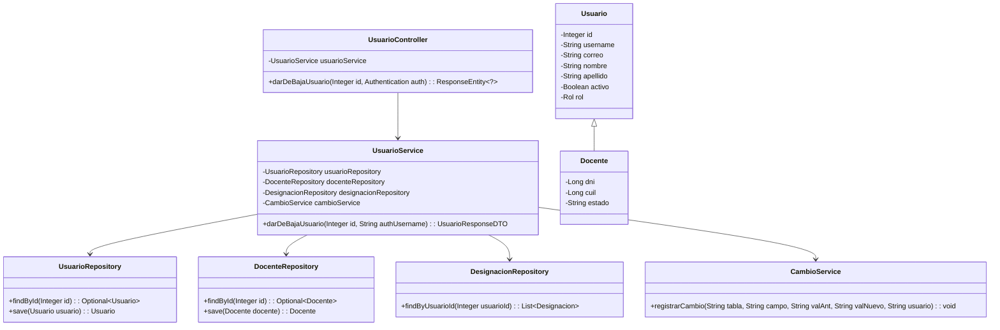
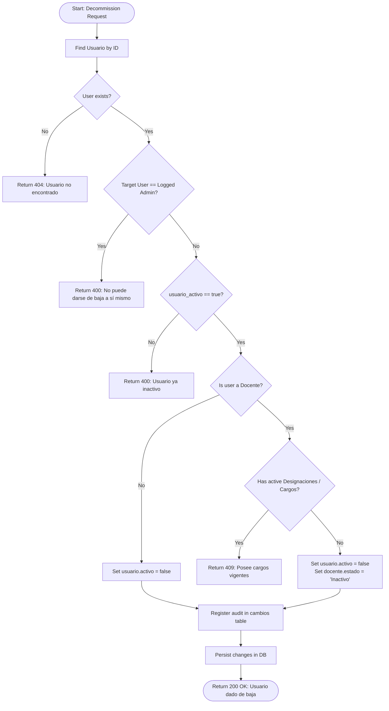

# Solution Diagrams — RF-35 (Baja de Usuario)

This document details the diagrams of the proposed solution for decommissioning any user in the system.

---

## 1. Sequence Diagram (Mandatory)

Shows the sequence flow of decommissioning a user, illustrating the interaction between the Global Administrator, Controller, Service, Repositories, and Audit service.

---

## 2. Class Diagram (Mandatory)

Shows the classes, interfaces, attributes, and methods involved in the solution and their relationships.

---

## 3. State & Validation Flow Diagram

Illustrates the decision logic, business rule validations, and resulting state transition during user decommissioning.

