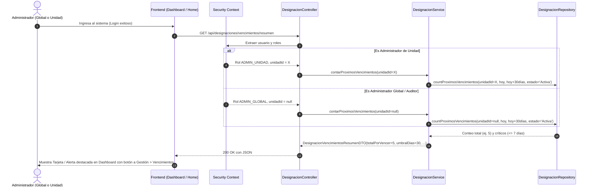
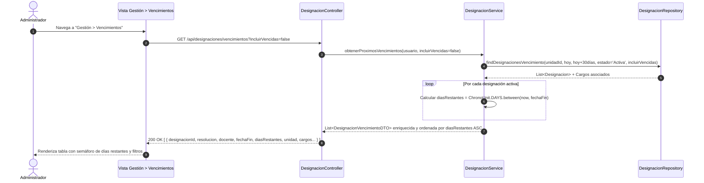

# Solution Diagrams — RF-36: Control de Próximos Vencimientos de Designaciones

## 1. Arquitectura y Flujo de Control de Acceso (RBAC y Multi-tenant)

```mermaid
flowchart TD
    subgraph Cliente["Frontend (Web UI)"]
        UI_Login["Ingreso al Sistema (Dashboard / Inicio)"]
        UI_Vencimientos["Módulo Gestión > Vencimientos"]
    end

    subgraph API["Atlas Backend API"]
        C_Resumen["GET /api/designaciones/vencimientos/resumen"]
        C_List["GET /api/designaciones/vencimientos?incluirVencidas=false"]
        SecFilter["Spring Security Context (Roles & Claims)"]
        Service["DesignacionService"]
    end

    subgraph Persistencia["Base de Datos PostgreSQL"]
        DB[(designaciones, cargos, docentes, unidades)]
    end

    UI_Login -->|1. Consulta resumen para tarjeta/alerta en Dashboard (30 días)| C_Resumen
    UI_Vencimientos -->|2. Consulta grilla detallada con opción de incluir vencidas| C_List

    C_Resumen --> SecFilter
    C_List --> SecFilter

    SecFilter -->|Validar Rol e Inyectar scope de Unidad| Service
    Service -->|Query filtrando estado='Activa' y rango de fechaFin| DB
    DB -->|Retorna entidades| Service
    Service -->|DTO enriquecido con días restantes| UI_Vencimientos
```

---

## 2. Diagrama de Secuencia — Consulta de Alertas al Ingresar al Sistema (Dashboard Card)



---

## 3. Diagrama de Secuencia — Consulta del Listado en Gestión > Vencimientos


