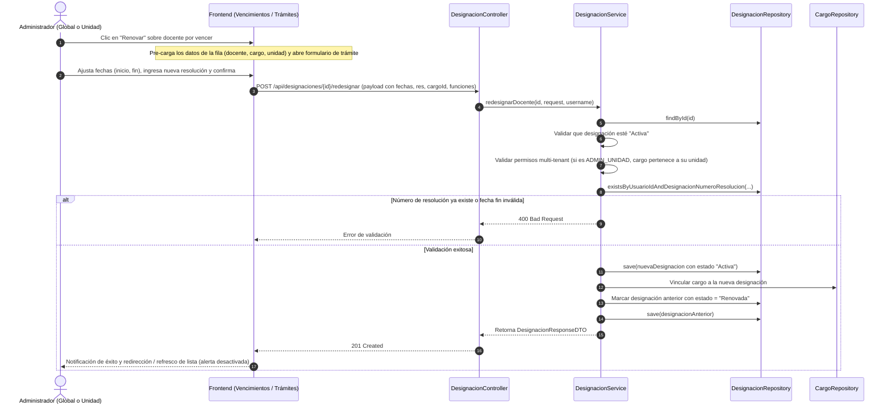
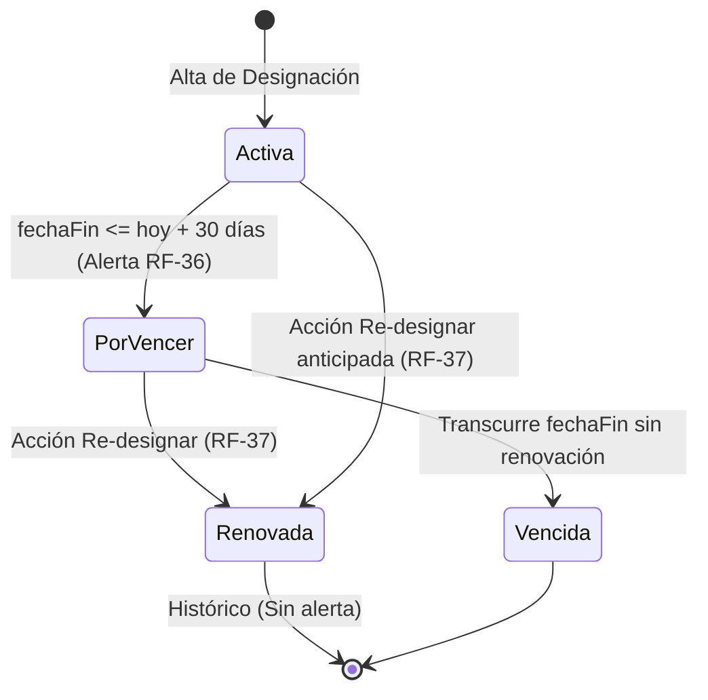
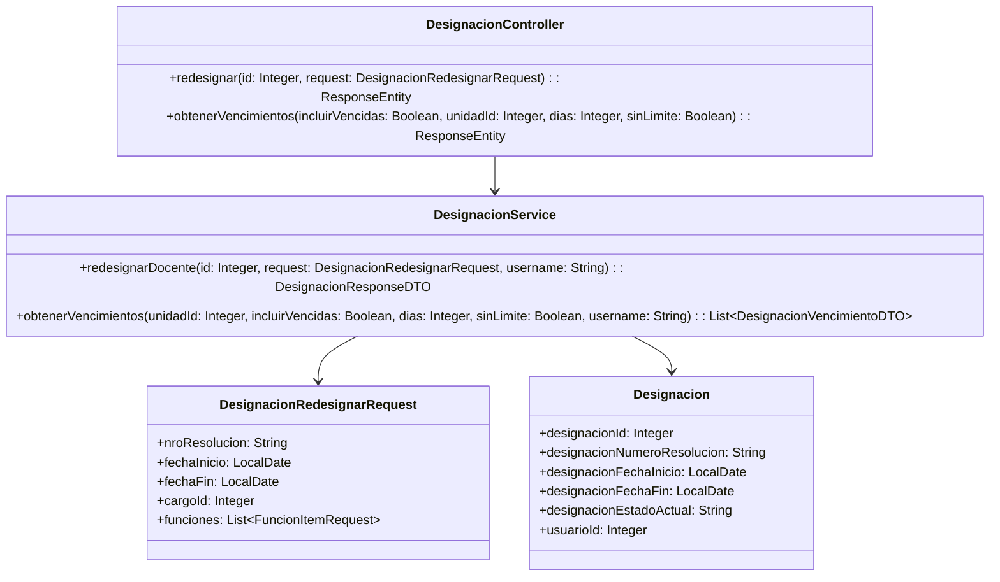

# Solution Diagrams — RF-37

Documentación técnica y diagramas de interacción para la re-designación simple de docentes con designación próxima a vencer.

---

## 1. Diagrama de Secuencia: Flujo de Re-designación Simple

Muestra el flujo completo desde la vista de Vencimientos, pasando por la precarga de datos, edición y persistencia de la nueva designación con baja/renovación de la anterior.

---

## 2. Diagrama de Estado: Ciclo de Vida de la Designación

Ilustra la transición de estados de la entidad `Designacion` al ser renovada.

---

## 3. Diagrama de Arquitectura de Clases y DTOs

