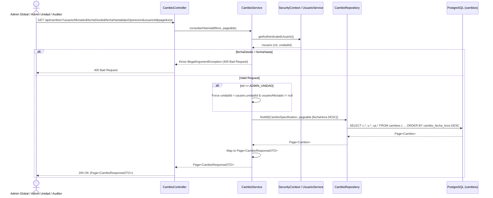
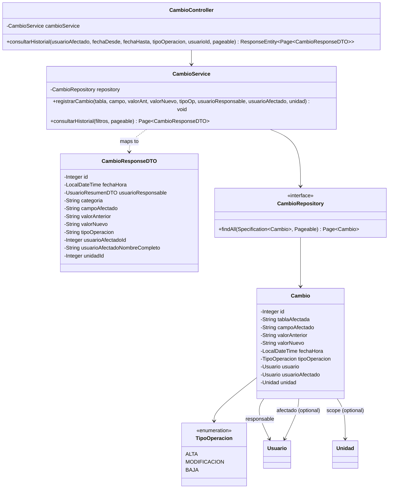
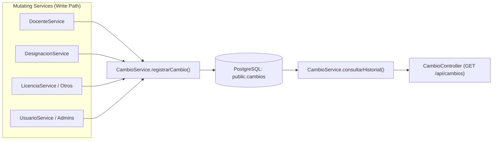

# Solution Diagrams — RF-39

This document details the diagrams of the proposed solution to understand the implementation of the Change History (RF-39).

---

## 1. Sequence Diagram (Mandatory)

Flow for querying the change history (`GET /api/cambios`) with RBAC unit scoping and dynamic filtering.

---

## 2. Class Diagram (Mandatory)

Static structure of the `cambio` package and its relationships with `Usuario` (responsable y afectado) and `Unidad`.

---

## 3. Additional Useful Diagram — Audit Recording & Consultation Data Flow

Illustrates how mutating services feed `CambioService` and how `CambioController` reads from the same audit store with RBAC filtering.

